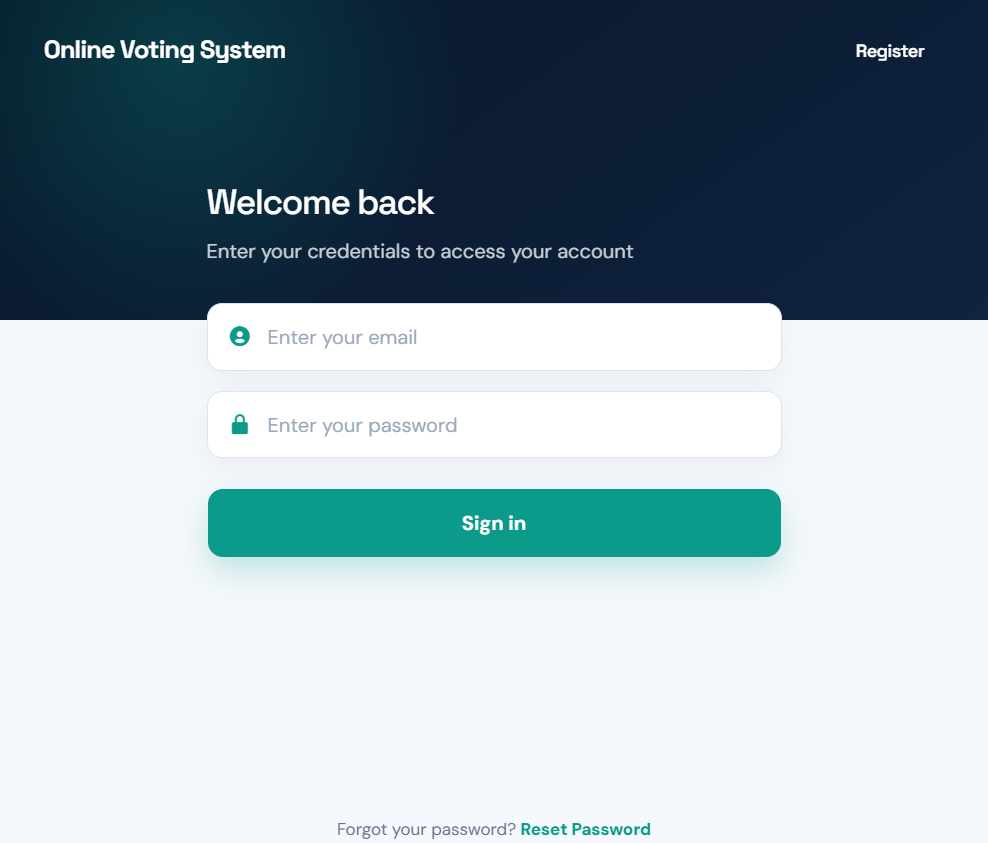
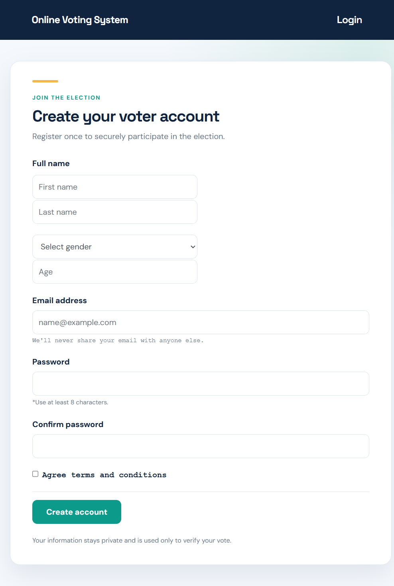
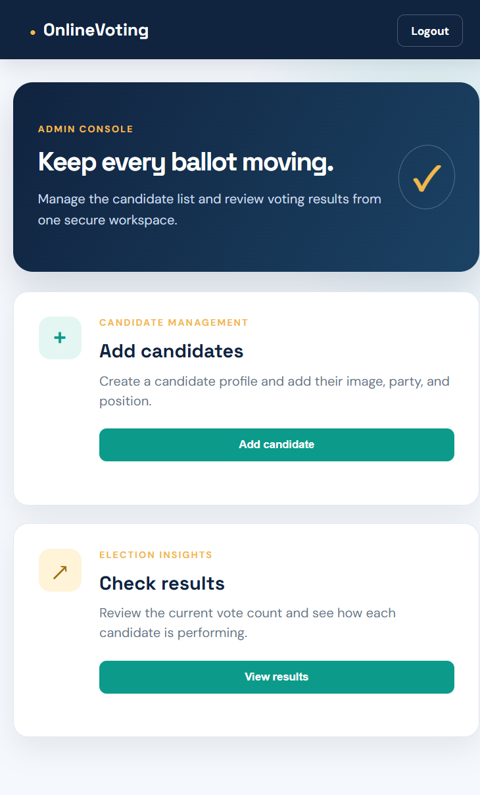
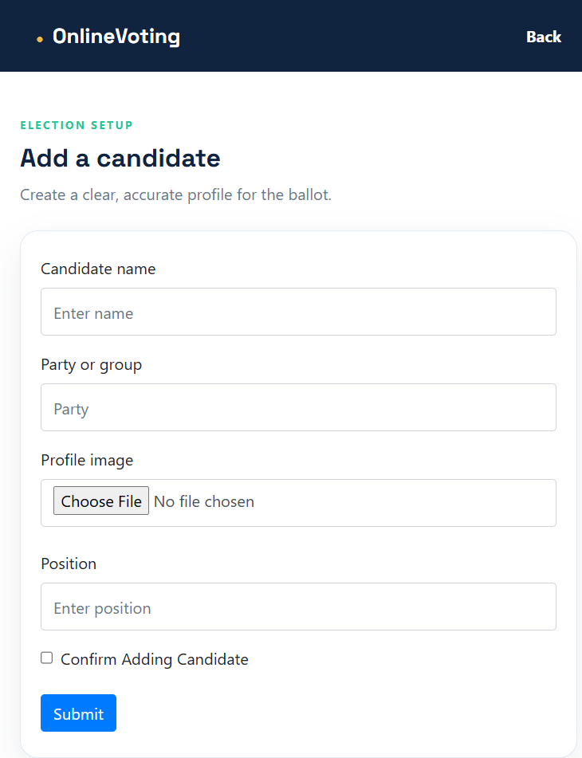
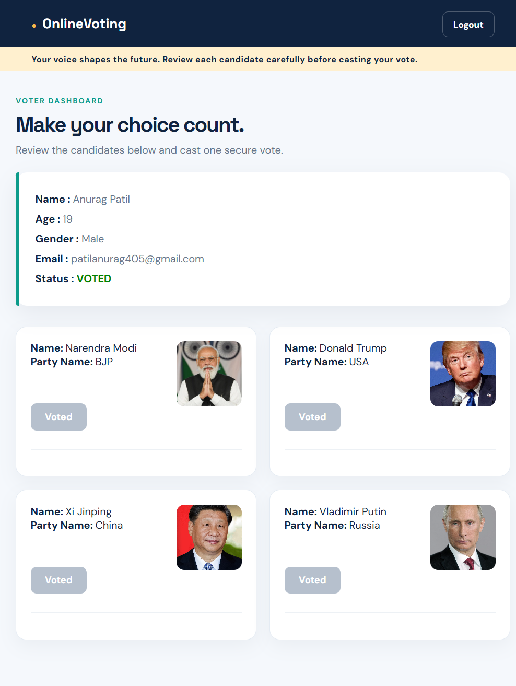
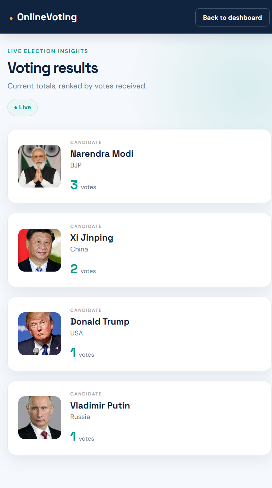

# Online Voting System

A PHP and MySQL voting application with separate voter and administrator workflows. Voters can register, sign in, review candidates, and cast one vote. Administrators can add candidates and review election totals.

## Features

- Voter registration and login
- Administrator login
- Secure password hashing with legacy-password migration on login
- CSRF protection on state-changing forms
- Server-side authorization for voter and admin pages
- One-vote-per-user enforcement with an atomic database transaction
- Candidate profile image upload validation
- Responsive voter and admin interfaces
- Ranked election-results view

## Technology

- PHP 8.1+
- MariaDB/MySQL
- Apache
- HTML, CSS, and Bootstrap utilities

## Requirements

- [XAMPP](https://www.apachefriends.org/) or another Apache/PHP/MySQL stack
- PHP 8.1 or newer
- MySQLi and the PHP `fileinfo` extension enabled
- A modern browser

## Installation

### 1. Clone the repository

Place the project inside your Apache document root:

```text
C:\xampp\htdocs\Voting-System
```

Or clone it directly:

```bash
cd C:\xampp\htdocs
git clone https://github.com/Anurag-cod4fun/Voting-System.git
```

### 2. Start XAMPP

Open the XAMPP Control Panel and start:

- Apache
- MySQL

### 3. Create the database

1. Open [phpMyAdmin](http://localhost/phpmyadmin).
2. Create a database named `pblvoting`.
3. Select the database.
4. Import [`pblvoting.sql`](./pblvoting.sql).

The default local connection is configured in [`partials/dbconnect.php`](./partials/dbconnect.php):

```php
$server = "localhost";
$username = "root";
$password = "";
$database = "pblvoting";
```

If your MySQL credentials differ, update that file before opening the application.

### 4. Open the application

- [User login](http://localhost/Voting-System/login/login.php)
- [Registration](http://localhost/Voting-System/Registration/reg.php)
- [Admin login](http://localhost/Voting-System/login/adminlogin.php)

## Demo credentials

The SQL dump contains a sample administrator account for local testing:

```text
Email:    anuragspatil88@gmail.com
Password: patilanurag
```

Change or remove this account before deploying anywhere other than a local development machine.

The dump also contains sample voter records. You can create a fresh voter account from the registration page.

## Application routes

| Area | Route |
| --- | --- |
| Register | `Registration/reg.php` |
| Voter login | `login/login.php` |
| Admin login | `login/adminlogin.php` |
| Voter dashboard | `Dashboard/userdash.php` |
| Add candidate | `Dashboard/candidates.php` |
| Election results | `Dashboard/results.php` |
| Logout | `Dashboard/logout.php` |

## Typical test flow

### Voter

1. Open the registration page.
2. Create an account with a password of at least eight characters.
3. Sign in through the voter login page.
4. Review the candidate cards.
5. Cast one vote.
6. Confirm the account shows `VOTED`.
7. Try submitting another vote and confirm it is rejected.
8. Log out and confirm protected pages redirect to login.

### Administrator

1. Sign in using the administrator credentials.
2. Open **Add candidate**.
3. Enter the candidate details and upload a JPG, JPEG, PNG, or GIF image no larger than 2 MB.
4. Open **Check results** and confirm the candidate appears in the totals.
5. Log out and confirm administrator pages are protected.

## Frontend preview

The preview includes the main voter and administrator screens, including the voter candidate view and the administrator results view.

### Voter login



### Registration



### Administrator dashboard



### Candidate management



### Voter dashboard



### Election results



## Security notes

- Passwords are stored with `password_hash()`.
- Older plaintext sample records are upgraded after a successful login.
- Do not use the sample credentials in production.
- Update the database password in [`partials/dbconnect.php`](./partials/dbconnect.php) for your environment.
- Keep the `Dashboard/uploads/.htaccess` file in place.
- Use HTTPS and a strong database password for deployment.
- The application is intended for local/demo use and should receive a production security review before public deployment.

## Troubleshooting

### Database connection failed

Check that MySQL is running, the database is named `pblvoting`, and the values in [`partials/dbconnect.php`](./partials/dbconnect.php) match your local setup.

### Page redirects to login

This is expected for protected pages. Sign in through the correct user or administrator login first.

### Uploaded images do not display

Confirm that `Dashboard/uploads/` exists and that Apache can read it. Keep the upload directory protection file in place.

### CSS changes do not appear

Perform a hard refresh:

- Windows/Linux: `Ctrl + F5`
- macOS: `Cmd + Shift + R`

## License

This project does not currently declare a software license. Add a license before redistributing it.
